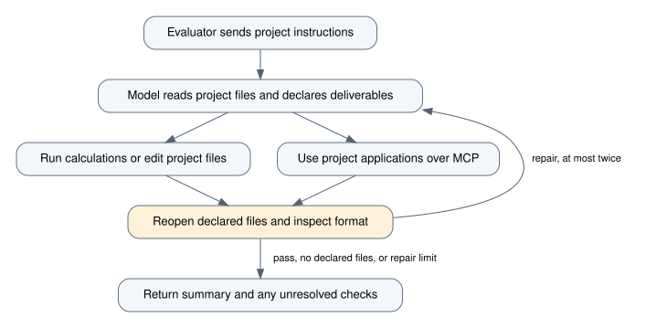
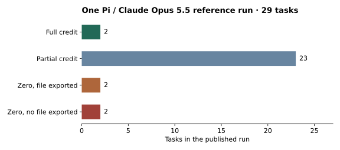

# PLE Deliverable Check

An autonomous harness for Physical-Engineering’s Last Exam. Before finishing, the model declares the files requested by the task. The harness reopens each path in the evaluator's task container. It sends missing, empty or malformed outputs back for up to two repair attempts. For an application-only assignment, the model names the destination and uses MCP to write and read back the record.



## Why check the handoff?

In the organizers' published Pi / Claude Opus 5.5 run, all 29 task sessions ended normally. Two earned zero reward with no exported file, two earned zero with an exported file, 23 earned partial credit, and two earned full credit. The mean reward was 0.49124. These are measurements from one organizer run. The two zero-score tasks with files were both routing problems. The manifest alone cannot identify the geometric cause.



[Reference run manifest](https://github.com/physical-engineerings-last-exam/submission-template/blob/22c26a93a9e4974b16e4351faab0e860ff9fb24f/artifacts/manifest.json)

## Implementation

The evaluator starts `serve.py` over WebSocket. The agent calls its declared model through the injected OpenAI-compatible endpoint. It can use shell commands inside the isolated task project, write files and discover or invoke task-local MCP tools. It reports model usage to the evaluator and caps model turns. The verifier checks Office container members and XML, ZIP integrity, JSON parsing, CSV readability, PDF markers and the IFC STEP envelope. An IFC needs independent geometry and clash checks to establish design correctness. File declarations come from the model, so an omitted file can escape verification.

The Stage 2 target is `google-cloud/gpt-oss-120b`. Comparative model performance and dev-set cost have yet to be measured. No leaderboard score is claimed.

## Reproduce

Use Python 3.12. Install `requirements.txt` in a virtual environment and run:

```sh
python -m unittest discover -s tests -v
```

The synthetic WebSocket test starts a local scripted model endpoint, asks for a missing deliverable and verifies that the repair is present on disk before the final completion frame.

For the benchmark, clone the official PLE kit next to this repository. Use a Docker host sized for at least 6 CPUs and 16.25 GB allocated for a full dev run, plus storage for the task images. Give the runner access to the gated dataset and a model endpoint. Load keys outside the entry repository. From the official kit checkout:

```sh
uv tool install harbor==0.20.0 --with websockets
uv run python -m kit validate ../ple-deliverable-check
uv run python -m kit check ../ple-deliverable-check
uv run python eval/run.py ../ple-deliverable-check
uv run python -m kit artifacts ../ple-deliverable-check
uv run python -m kit check ../ple-deliverable-check
```

The first full check may report missing artifacts before the dev run. Keep the generated artifacts with the precise harness revision that produced them. For local open-weight experiments follow the kit's local-model recipe. For a paired ablation, set `PLE_CHECK_OUTPUTS` to `"0"` in the experimental entry's `submission.yaml` env block. Match task order, model version and call budget between configurations. Vary `PLE_MAX_CALLS` to measure reward against tokens and elapsed time. Store experimental checkouts and run logs separately from the final entry.

[Official competition kit](https://github.com/google-research/ple) · [Local model configuration](https://github.com/google-research/ple/blob/main/docs/local-models.md)

## Attribution

Apache License 2.0. The unchanged `taskbridge.py` is from Google's PLE repository. The agent, output inspector and synthetic tests are specific to this entry. The organizers' reference outputs are excluded from this harness.
