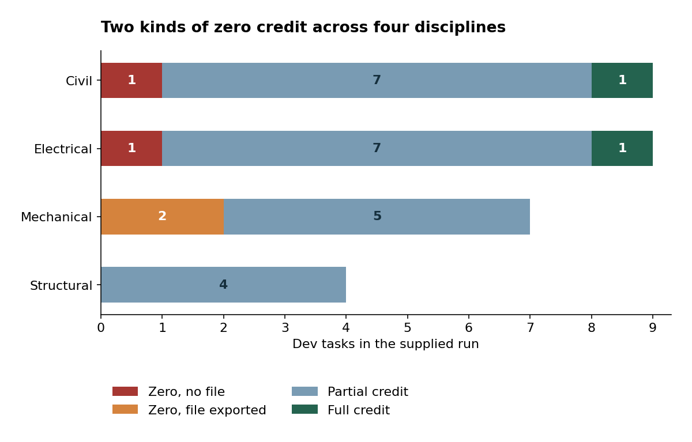
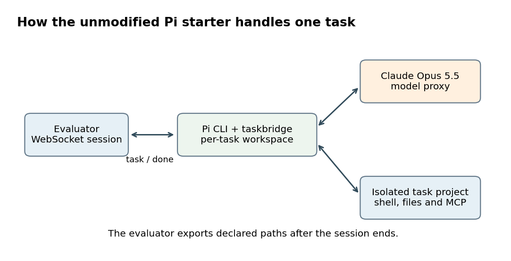
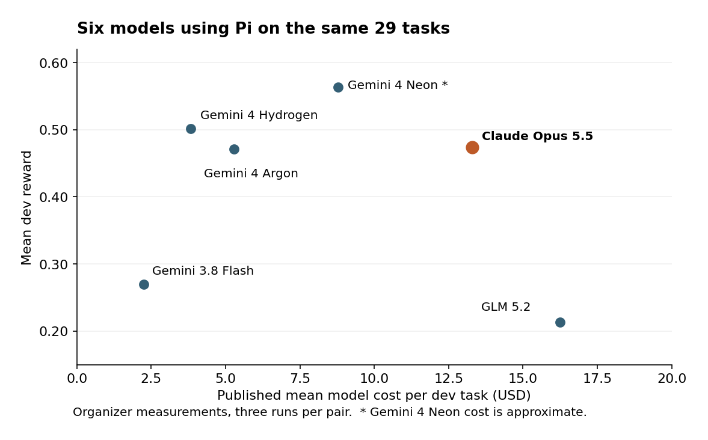

# What 280 tool calls missed in two engineering tasks

**Starter commit** `22c26a93a9e4974b16e4351faab0e860ff9fb24f`  
**Harness and model** Pi 1.1.0 with `google-cloud/claude-opus-5-5`  
**Scope** Independent analysis of the unmodified organizer starter, its exported files, and its 29 public trajectories. The organizers generated the runs reported here.

Two data-hall routing tasks together consumed 280 tool calls. Both sessions ended normally, both produced the requested Python script, and both scored zero. Another task, a data-center site model, earned full credit after 37 tool calls. For this set of artifacts, counting calls or checking that a file exists would have missed the most expensive pair of zero-score outcomes in tool calls.

## Which failures can a file check catch?

I joined each task's reward from the pinned artifact manifest to its exported file list and its Pi trajectory. I counted individual tool invocations, including multiple calls in the same step. The mean reward across the 29 tasks was **0.49124**. Two tasks earned full credit, 23 earned partial credit, and four scored zero. Together the four zero-score tasks accounted for 381 of 2,691 tool calls (14.2%).

The foundation strategy and solar witness package had no exported deliverable files. The solar session's last message described the next action it intended to take. The foundation session ended with a tool-call marker. A completion check that asks an agent to reopen its required deliverable could detect a missing file if the agent identified the right path. As a retrospective failure detector, “no exported file” flagged two of four zero-score tasks and none of the 25 positive-score tasks. With 29 observations and different delivery formats, this is a diagnostic for this run. Any score improvement from that intervention remains unmeasured.

The two routing tasks had a different failure signature. The standard layout used 122 tool calls, and the offset layout used 158. Each exported `solution.py`, exactly the path the official dev-set definition collects. The final summaries also described an IFC model and a reconciliation file. Their absence from the export is expected because the grader collects the generator script. Inferring the cause of either zero from the missing IFC would be a mistake.

## Where the engineer would check the work

An IFC file describes objects such as equipment and piping, including their positions and geometry. For the offset layout, Pi's handoff documented an assumed equipment-facing axis, an interpretation of drawing grid labels, and a decision to route services below the floor. These were assumptions with consequences for clearance and connectivity. The final message records what the agent believed. It does not independently validate those choices.

A reviewer could select one equipment row, trace a connected route through the drawings, and compare the inlet, equipment front, crossing elevations and end connections with a fresh build from the delivered script. The important distinction is between checking the generator's output against its own assumptions and checking those assumptions against independent evidence. The available reward does not identify which constraint failed, so I cannot attribute the zeros to a particular clash or coordinate error.

The starter starts Pi in a temporary per-task workspace. The competition bridge relays shell, file and application operations to the isolated task project. Model usage and the final reply go back to the evaluator. The evaluator separately collects files at the task's declared paths. That separation explains how a well-formed final summary and a zero deliverable score can coexist.

## Model choice and cost

The public leaderboard supplies a broader comparison using the same Pi harness. Its figures average three runs per model over the 29 dev tasks. The single packaged Opus run and the leaderboard mean are different samples.

| Pi model | Mean dev reward | USD per task | Minutes per task |
|---|---:|---:|---:|
| Claude Opus 5.5 | 0.474 | 13.29 | 71 |
| Gemini 4 Hydrogen | 0.502 | 3.82 | 42 |
| Gemini 4 Neon | 0.563 | approximately 8.78 | 52 |
| GLM 5.2 | 0.213 | 16.25 | 129 |

On these dev measurements, Hydrogen scored 0.028 above Opus at about 29% of its cost per task. The unchanged starter remains paired with Opus because that model produced the archived outputs. The cross-model results come from the organizers. They do not establish how a change in verification would transfer between models.

The trajectories give an observed effort distribution. They cannot establish a plateau at a particular call budget because task difficulty and the number of calls vary together. The experiment I would use to test early verification is a paired run at equal budgets, with the checker enabled or disabled, reporting both changes in reward and repair costs. No controlled ablation or hidden-set result is claimed here.

## Reproducibility

The participant-owned entry branch preserves the organizer's original commit. The current official kit accepted the configuration and artifact directory and built a 139 MiB evaluation bundle in Docker. It counted 28 usable task outputs, marked the foundation strategy task empty, and warned of a dev-set revision change. The published 0.49124 is the historical manifest mean. Live model and smoke checks are pending an authorized model proxy.

To reproduce the aggregate counts, run `python audit.py /path/to/starter /path/to/ple tasks.json` with PyYAML installed, then `python figures.py` with Matplotlib installed. Use the two pinned commits linked below. The plotted model-cost points come from the public leaderboard.

[Participant-owned starter commit](https://github.com/Rahulchaube1/ple-deliverable-check/tree/22c26a93a9e4974b16e4351faab0e860ff9fb24f) · [Organizer source and artifacts](https://github.com/physical-engineerings-last-exam/submission-template/tree/22c26a93a9e4974b16e4351faab0e860ff9fb24f) · [Official dev leaderboard](https://ple-bench.com/leaderboard?set=dev) · [Official task definitions](https://github.com/google-research/ple/blob/5cf736f8b6e6f28eea71cae52de0c3bedaa88fa2/eval/dev_set.yaml) · [Verification run](https://github.com/Rahulchaube1/ple-deliverable-check/actions/runs/45340695374)
